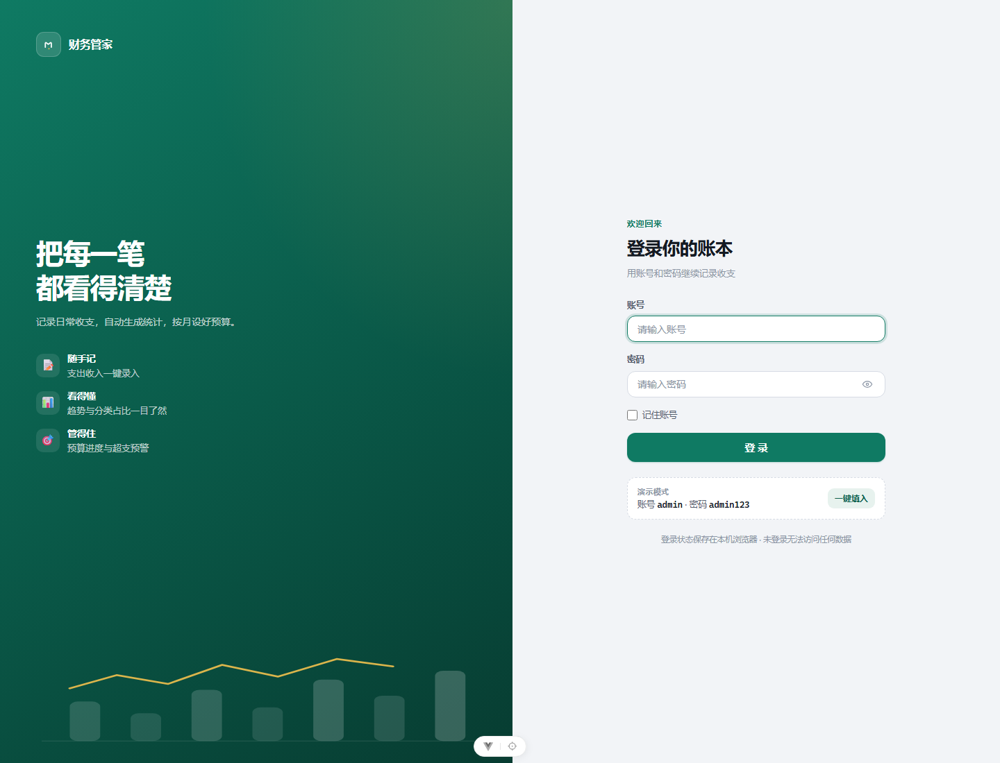
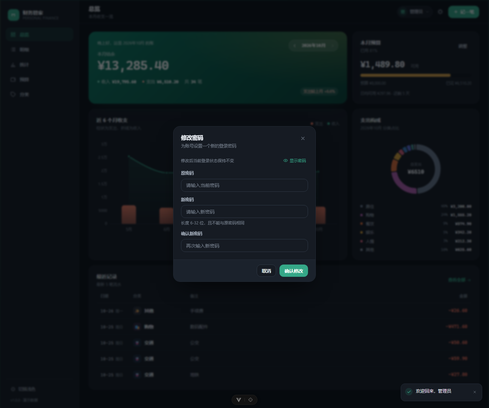
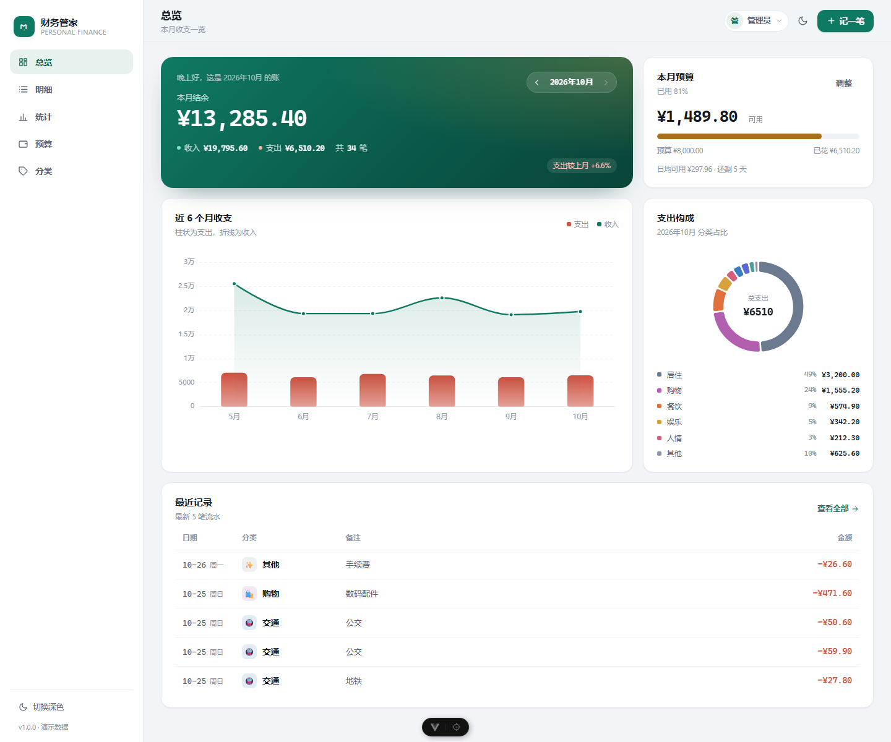
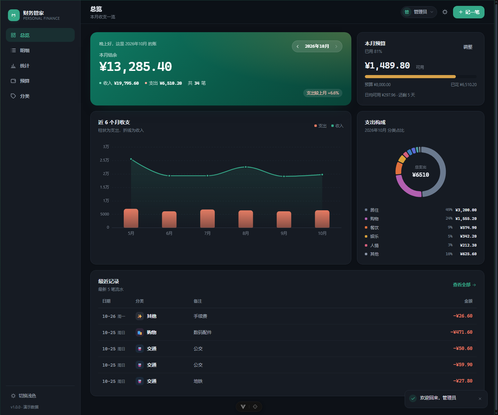
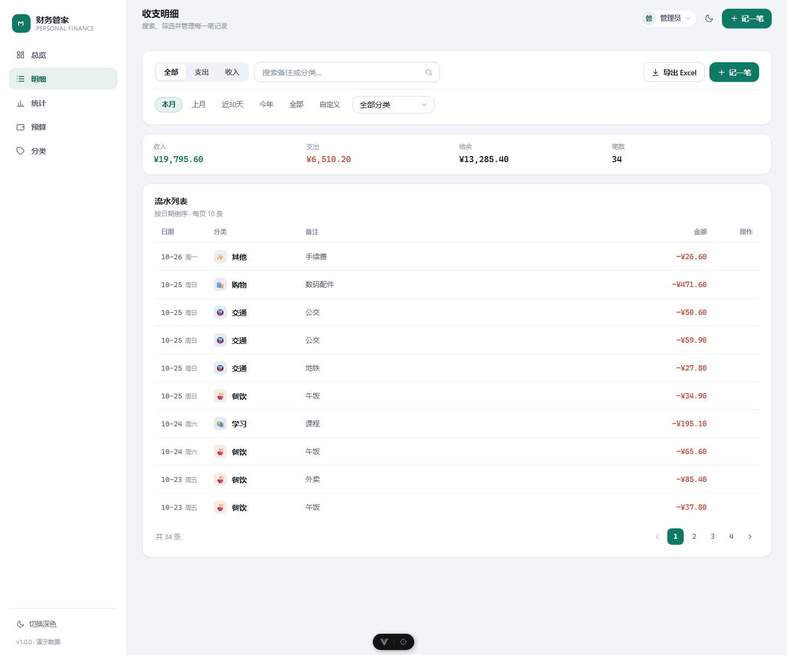
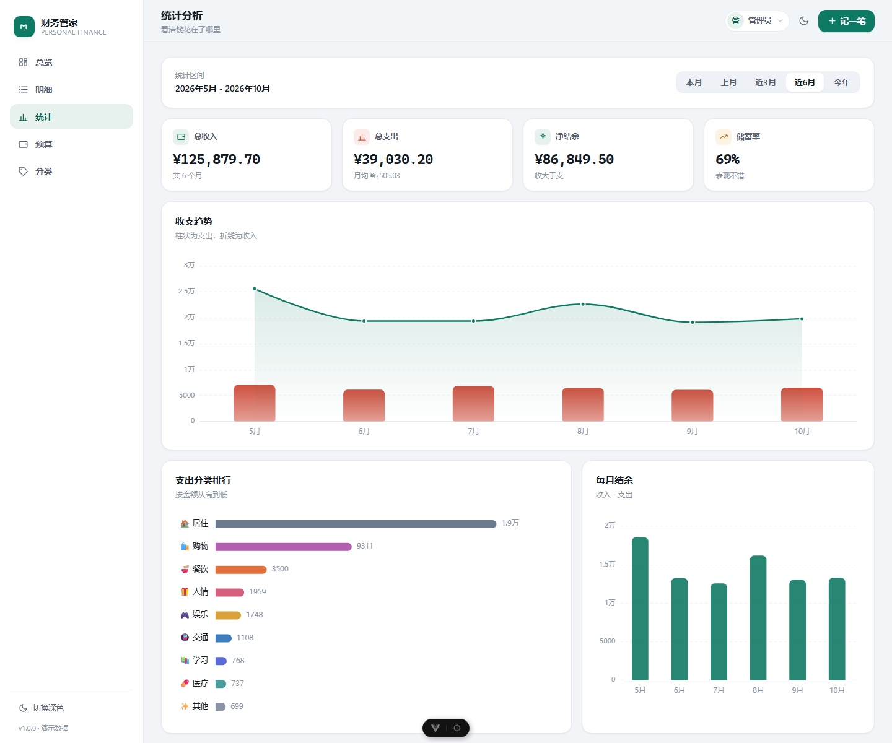
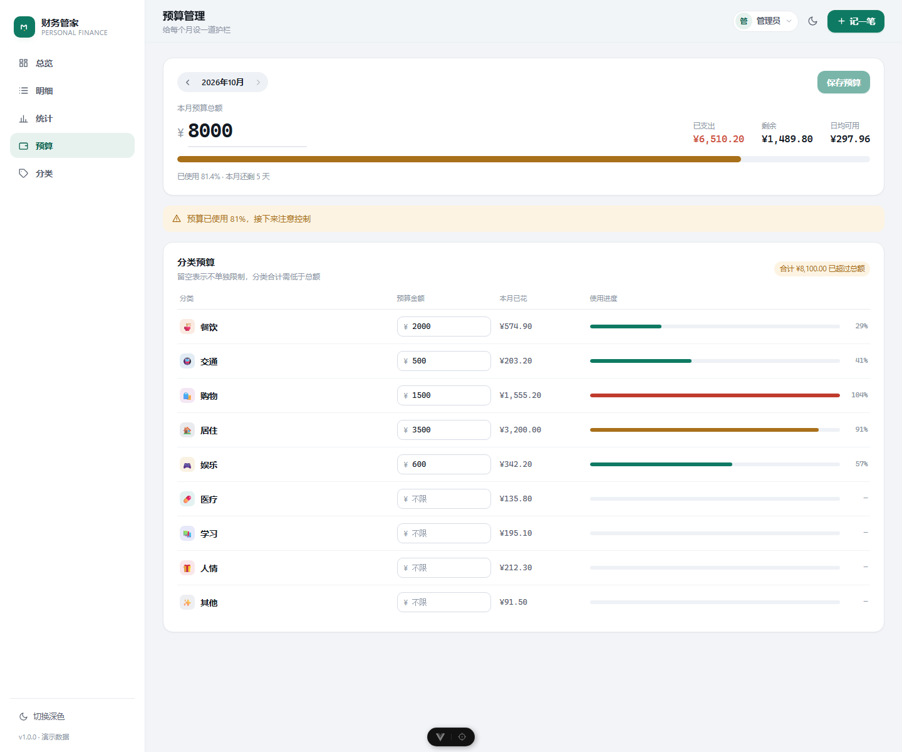

# 财务管家 · 个人财务管理前端

一个自用的记账与财务分析工具：记录每一笔收支，自动汇总成图表，按月设定预算。
纯前端 + 浏览器本地演示数据即可完整运行；后端接口按 REST 契约预留，接上 Spring Boot 后关闭模拟开关即可。

- 技术栈：Vue 3.5 + TypeScript + Vite 8 + Pinia + Vue Router + ECharts 6 + Axios
- 后端：Java 21 + Spring Boot 4 + PostgreSQL（接口约定见 [docs/backend-api.md](docs/backend-api.md)）
- 无 UI 组件库，样式由设计令牌自建，支持浅色 / 深色主题

## 功能

| 模块 | 能力 |
| --- | --- |
| 登录 | 账号 + 密码登录、记住账号、未登录拦截、会话失效自动退出、修改密码、退出登录 |
| 总览 | 本月结余、收支合计、近 6 个月趋势、支出构成环形图、预算进度、最近 5 笔 |
| 明细 | 关键字搜索（防抖）、类型/分类/时间区间筛选、分页、编辑、删除、导出 Excel |
| 统计 | 本月/上月/近 3 月/近 6 月/今年区间切换、收支趋势、分类排行、每月结余、月度明细表 |
| 预算 | 月度总预算 + 分类预算、实时已花金额与使用进度、超支与 80% 预警、日均可用 |
| 分类 | 支出/收入分类管理，emoji 图标 + 配色，分类被引用时拒绝删除 |
| 体验 | 全局快捷记账、Toast 提示、确认弹窗、骨架屏、空状态、深浅主题、移动端底部导航 |

## 界面预览

| 登录 | 修改密码 |
| --- | --- |
|  |  |

| 总览（浅色） | 总览（深色） |
| --- | --- |
|  |  |

| 收支明细 | 统计分析 | 预算管理 |
| --- | --- | --- |
|  |  |  |

> 截图中的数据由内置 mock 生成，仅用于演示。

## 快速开始

```bash
npm install
npm run dev
```

打开 http://localhost:5173 —— 首次访问会跳到登录页，用**演示账号**登录：

```
账号：admin
密码：admin123
```

登录页上提供了「一键填入」按钮，模拟模式下还会直接显示这组账号。

默认启用**模拟数据**（`VITE_USE_MOCK=true`），无需后端即可完整体验：
首次进入会在 `localStorage` 生成最近 7 个月的示例流水，新增/编辑都会持久化，刷新不丢。

> 模拟模式下修改的密码会存在浏览器里（`pf.mock.password`），**且 `admin123` 始终可用**，
> 避免忘记新密码把自己锁在外面；接入真实后端后没有这个后门。

### 常用脚本

| 命令 | 说明 |
| --- | --- |
| `npm run dev` | 启动开发服务器（含 `/api` 代理） |
| `npm run build` | 类型检查 + 生产构建，产物在 `dist/` |
| `npm run preview` | 本地预览生产构建（同样带 `/api` 代理） |
| `npm run type-check` | 仅运行 vue-tsc 类型检查 |
| `npm run lint:check` | ESLint 检查（`npm run lint` 会自动修复） |
| `npm run format:check` | Prettier 格式检查（`npm run format` 会写入） |
| `npm test` | 运行工具函数单测（金额 / 日期） |

## 环境变量

| 变量 | 文件 | 说明 |
| --- | --- | --- |
| `VITE_APP_TITLE` | `.env` | 应用标题 |
| `VITE_API_BASE_URL` | `.env` | 前端请求前缀，默认 `/api` |
| `API_PROXY_TARGET` | `.env.development` | 开发代理目标，固定 `http://localhost:9081`（无 `VITE_` 前缀，不会打进产物） |
| `VITE_USE_MOCK` | 各环境 | `true` 使用本地模拟数据，`false` 请求真实后端 |

> 目前只有开发环境：`npm run dev` 与 `npm run preview` 都把 `/api` 转发到 `9081`。
> 生产环境尚未部署，等 Nginx / Docker 定稿后再补 `.env.production` 的代理地址。

## 对接后端

1. 按 [docs/backend-api.md](docs/backend-api.md) 实现接口，服务端口建议 `9081`，`context-path` 设为 `/api`。
2. 先把鉴权跑通：`POST /api/auth/login` 返回 `{ token, user }`，其余接口校验 `Authorization: Bearer <token>`。
3. 把 `.env.development` 里的 `VITE_USE_MOCK` 改成 `false`，重启 `npm run dev`。
4. 浏览器请求 `/api/...` 会由 Vite 代理转发到 `http://localhost:9081/api/...`，不存在跨域问题。

切换后如果后端没起来，页面会提示「无法连接后端服务」，属于预期行为。

## 目录结构

```
src/
├─ api/                  # 接口层：axios 实例 + 各领域接口封装
│  ├─ client.ts          # baseURL、Bearer Token、错误归一化 → ApiError、401 回调
│  ├─ auth.ts            # 登录 / 当前用户 / 退出
│  ├─ transactions.ts    # 流水列表/增删改/汇总/导出
│  ├─ categories.ts      # 分类
│  ├─ stats.ts           # 月度趋势、分类占比
│  └─ budgets.ts         # 预算
├─ mock/                 # 仅开发期：拦截 axios，按真实契约返回数据
│  ├─ adapter.ts         # 路由 + 鉴权 + 校验 + 统计逻辑（与后端语义一致）
│  ├─ database.ts        # 种子数据 + localStorage 持久化
│  └─ index.ts           # installMockApi()
├─ stores/               # Pinia：auth / ui(主题/弹窗) / category / toast / confirm / sync
├─ components/
│  ├─ ui/                # 通用组件：按钮、输入、下拉、弹窗、分页、进度条…
│  ├─ charts/BaseChart   # ECharts 容器（按需注册、自适应）
│  ├─ layout/            # 侧边栏、顶栏（含用户信息与退出）
│  ├─ records/           # 记账表单、流水表格
│  └─ categories/        # 分类表单
├─ views/                # 6 个页面：登录 / 总览 / 明细 / 统计 / 预算 / 分类
├─ utils/                # 金额、日期、图表配置、下载、会话存储
├─ types/                # 与后端一一对应的领域类型
└─ assets/styles/        # 设计令牌 + 基础样式
```

## 设计说明

- **设计令牌**：颜色、圆角、阴影、字体集中在 `src/assets/styles/main.css`，深色主题只是覆盖一组变量，组件零改动。
- **图表**：ECharts 按需注册（Bar/Line/Pie + Grid/Tooltip），主题色在 `utils/chartTheme.ts` 与 CSS 令牌保持一致；配置集中在 `utils/chartOptions.ts`。
- **数据刷新**：新增/修改/删除后调用 `useSyncStore().bump()`，各页面 `watch` 版本号重新拉取，避免层层传事件。
- **金额精度**：接口以「元」传输，前端累加时统一转「分」做整数运算，避免 `0.1 + 0.2` 误差。
- **响应式**：≥960px 左侧栏，小于则变为底部标签栏；表格在手机上隐藏备注列并收紧内边距，保证一屏可读。

### 鉴权实现

```text
登录页提交 → POST /auth/login → 拿到 token
           → 存 localStorage（pf.token / pf.user）
           → 每次请求自动带 Authorization: Bearer <token>
           → 任何接口返回 401 → 清空会话 + 跳登录页（带回跳地址）
```

- **所有页面**（包括直接输入的深链、不存在的路径）都受登录保护：路由守卫在 `src/router/index.ts`，除 `/login` 外一律校验登录态。
- 未登录访问 `记录/统计/预算/分类` 会跳到 `/login?redirect=原地址`，登录成功后自动回跳。
- 顶栏头像菜单里可以**修改密码**（`POST /auth/password`）或退出登录，退出前二次确认。
- 修改密码时**原密码错误必须返回 400 而不是 401**，否则会被全局 401 处理当成会话失效直接登出。
- 只记住账号（`pf.username`），不保存密码。
- 说明：token 放 localStorage 对 XSS 没有防护，个人自用可接受；若要更严格，可让后端改用 HttpOnly Cookie 承载会话。

## 后续可以加

- 预算提醒（浏览器通知 / 邮件）：后端加定时任务，前端加通知权限申请
- 账单导入（CSV / 支付宝、微信账单）
- 多账本、账本共享
- 多用户 / 修改账号（当前是单账号模型，密码已支持修改）
- 定期存款 / 理财持仓

## 部署

完整步骤见 **[docs/deployment.md](docs/deployment.md)**（ECS + Nginx，含发版/回滚/排错）。

```bash
# 本地：构建 + 打包成 dist.tar.gz（Windows 双击或命令行）
deploy\package.cmd

# 上传
scp dist.tar.gz root@<ECS_IP>:/tmp/

# 服务器：解压到新版本目录并原子切换
sudo bash deploy/deploy.sh /tmp/dist.tar.gz
```

配套文件：

| 文件 | 用途 |
| --- | --- |
| `deploy/package.cmd` / `package.ps1` | 本地构建 + 打包 |
| `deploy/deploy.sh` | 服务器发版 / 回滚 |
| `deploy/nginx.conf` | Nginx 站点模板（静态 + `/api` 反代 + 缓存 + 安全头） |
| `deploy/finance-api.service` | 后端 Spring Boot 的 systemd 单元 |

约定：开发固定用 `9081`，生产端口与 Nginx upstream、后端 `server.port` 保持一致即可。
前端与后端同域部署时不需要 CORS。
